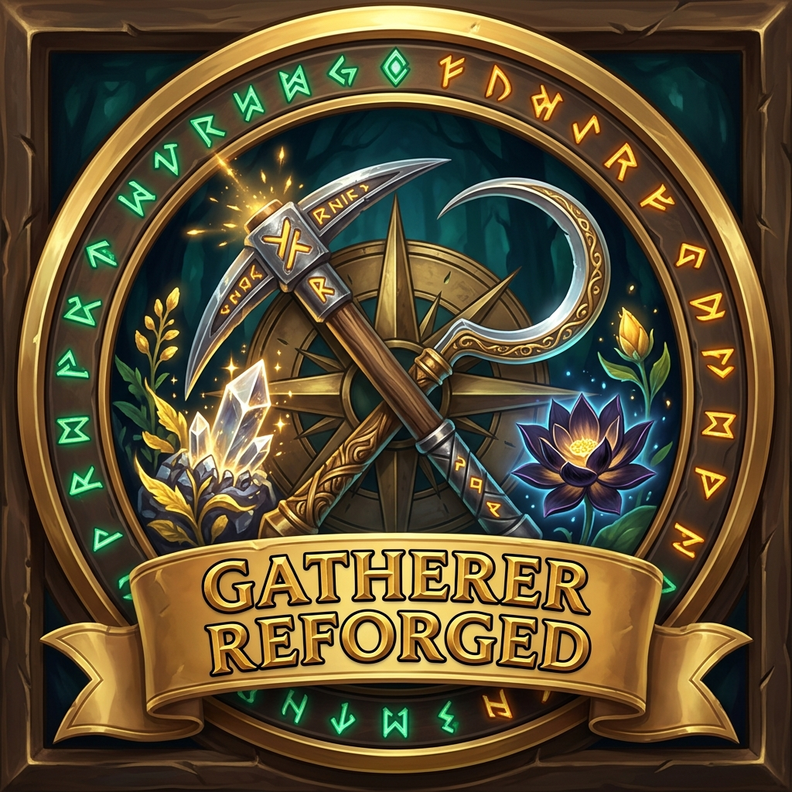

  

  # Gatherer Reforged

  **The legendary 2005 *Gatherer* addon by Norganna (last updated in 2017) — finally reforged for modern World of Warcraft!**

  
  
  

---

Every long-time World of Warcraft veteran remembers **Norganna's legendary *Gatherer***—one of WoW's original and most iconic addons, first created back in **2005 (Vanilla WoW)** and maintained by *Norganna's AddOns* until its last official release in **September 2017 (*Legion* Patch 7.3)**.

After **more than 20 years** since its birth in Vanilla and nearly a decade without an official update, **Gatherer Reforged** brings this classic back from the ashes! Completely modernized and rebuilt from the ground up with a native **`C_Map` mapping engine**, a modern **Ace3 configuration interface**, and the iconic **3D Heads-Up Display (HUD)** integrated directly into the core addon, it tracks your **Herbalism**, **Mining**, **Treasure**, and **Archaeology** nodes across **Retail (*The War Within* / *Midnight*)**, **WoW Forever**, and all **Classic** flavors.

---

## ✨ Key Features

- 🏛️ **The Classic Legend, Rebuilt for Modern WoW**: Preserves everything old-school WoW players loved about Norganna's *Gatherer* (per-node harvest history, drop percentages, guild/party node sync, and the 3D HUD) while stripping out all broken legacy libraries (`Astrolabe`, `Babylonian`, `DongleStub`, `SlideBar`, `!Swatter`).
- 🧭 **Integrated 3D Heads-Up Display (HUD)**: The famous *Gatherer HUD* plugin is now built right into the main addon—projecting a customizable 3D compass overlay in the center of your screen with distance, angle, pitch, heat-trail tracking, and automatic hide conditions (combat, flying, mounted, inside instances).
- 🌿 **Comprehensive Node Tracking**: Automatically records exact coordinates, harvest counts, drop rates, inspection times, and sources for **Herbs**, **Mining Veins**, **Treasure Chests / Containers**, **Fishing Schools**, **Gas Clouds**, and **Archaeology** dig finds.
- 💰 **Live Session & Gold-per-Hour (GPH) Tracker**: Tracks nodes gathered, nodes/hour, total session loot value, and **Gold per Hour (GPH)** in real time—displayed in your **LDB DataSource bar** (*Titan Panel*, *Bazooka*, *ElvUI DataTexts*), the Minimap button tooltip, and Ace3 Options.
- ⏱️ **Respawn Cooldown Dimming**: Recently harvested nodes are automatically dimmed on the Minimap and 3D HUD for a configurable respawn duration (default 5 minutes) so you always know which nodes on your farming route are still on cooldown.
- 🔮 **Dynamic "Forever" Node Discovery**: Automatically learns and persists brand-new or custom herbs, ores, and treasures in current and future expansions or custom realms (such as *WoW Forever*) without waiting for static database updates.
- 🗺️ **Native `C_Map` Engine**: Built directly on Blizzard's modern `C_Map` and `C_Minimap` APIs with full support for zone, continent, and world-level node projection.
- 🤝 **Real-Time Guild, Party & Raid Sync + Cross-Addon Sharing Bridge**: Automatically shares newly harvested nodes with guildmates and party/raid members in real time—and includes a built-in **Cross-Addon Sharing Bridge** that speaks **`GatherMate2_Sharing` (`GM2SD`)**, **`GatherMate_Sharing` (`GMSD`)**, and **`GatherLite`** protocols while also performing two-way live sync with local **`GatherMate2`** installations (replacing the long-discontinued `GatherMate2_Sharing` addon).
- 🔍 **Gatherables Report & Node Density Search**: Classic, fast overview windows to search, filter, mark, transmit, or delete nodes by zone, profession type, source, density percentage, or distance.

---

## 🧩 Full Map & UI Addon Compatibility

Gatherer Reforged works seamlessly alongside modern UI, map, and farming addons:

- **GatherMate2 & GatherMate2_Data Importer**: Built-in **1-click importer** (`/gather import` or via the *Integrations & DB* options tab) to import your existing `GatherMate2` SavedVariables and pre-populated Wowhead databases from `GatherMate2_Data` (including *Classic*, *TBC*, *Wrath*, *Retail*, and *WoW Forever*).
- **Auctionator, TradeSkillMaster (TSM) & OribosExchange**: Displays live Auction House market values per herb/ore directly inside World Map and Minimap node tooltips.
- **Routes & FarmHud**: Registers `GathererReforged` as a native data source in **Routes** (for automated TSP farming circuits) and automatically hooks **FarmHud** when toggled.
- **MapWise**: Full support for MapWise's custom **Terrain** and **Paper** rendering modes (`MapWiseAPI`), continent/Azeroth projections, and automatic integration into MapWise's **"Addons"** toolbar menu.
- **ElvUI**: Native support for **Square** and **Round** minimaps (`GetMinimapShape()`), click-passthrough for ElvUI's right-click tracking & middle-click micro menus, scaled World Map support, and automatic ElvUI skinning for Gatherer's Report and Search windows.
- **Leatrix Maps / SexyMap / BasicMinimap / Chinchilla**: Dynamic frame layering above map reveal overlays and full support for all custom minimap shapes (`SQUARE`, `ROUND`, `CORNER-*`, `SIDE-*`, `TRICORNER-*`).
- **TomTom & Native Waypoints**: `Shift + Right-Click` or `Alt + Left-Click` any Gatherer pin on the World Map to create a **TomTom** waypoint (or native Blizzard map pin).
- **LibDBIcon-1.0, LibDataBroker-1.1 & Addon Compartment**: Works with LDB bars (*Bazooka*, *Titan Panel*), *ElvUI WindTools* button bars, and Retail's Minimap Addon Compartment.

---

## 🎮 Supported WoW Versions

- **WoW Forever** (`16001`)
- **Retail / Midnight** (`12.x`)
- **Mists of Pandaria Classic** (`5.5.x`)
- **Cataclysm Classic** (`4.4.x`) & **Wrath Classic** (`3.4.x` / `3.8.x`)
- **Burning Crusade Classic Anniversary** (`2.5.x`)
- **Classic Era** (`1.15.x`)

---

## ⌨️ Slash Commands

Use `/gather`, `/gatherer`, `/gathererreforged`, or `/greforged`:

| Command | Description |
| :--- | :--- |
| `/gather` or `/gather options` | Open the Ace3 configuration window |
| `/gather report` | Open the Gatherables Report dialog |
| `/gather search` | Open the Node Density Search dialog |
| `/gather import` | Import `GatherMate2` & `GatherMate2_Data` databases |
| `/gather session` | Print current session statistics and Gold/Hour (GPH) |
| `/gather reset` | Reset current session statistics |
| `/gather on` / `/gather off` / `/gather toggle` | Enable, disable, or toggle Minimap tracking |
| `/gather dist <yards>` | Set maximum Minimap tracking distance |
| `/gather num <count>` | Set maximum number of Minimap notes displayed |
| `/gather herbs on\|off\|toggle` | Toggle Herbalism node display |
| `/gather mining on\|off\|toggle` | Toggle Mining node display |
| `/gather open on\|off\|toggle` | Toggle Treasure / Container node display |

---

## 📜 Credits & License

- **Author (Reforged Modernization)**: [gOOvER](https://github.com/gOOvER)
- **Original Gatherer Concept & Legacy**: Norganna's AddOns (Esamynn, MentalPower, jcarrothers)
- **License**: [GNU General Public License v3.0 (GPL-3.0)](LICENSE)
